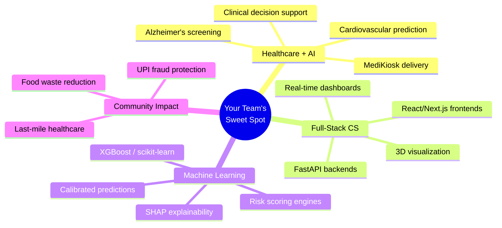

# SEVA 2026 — Strategic Problem Statement Recommendation

## Your Team's Portfolio DNA

Based on a deep analysis of every project in your workspace, here's your **proven tech stack and domain expertise**:

| # | Project | Domain | Core Tech Stack | Key Strengths Demonstrated |
|---|---------|--------|-----------------|---------------------------|
| 1 | **CogniPath** (BuildSprint) | 🧠 Healthcare / Alzheimer's Screening | FastAPI, C-engine (ctypes), scikit-learn, ML risk scoring, Tailwind dashboard | ML-powered clinical triage, microsecond-latency C-optimized ranking, NLP biomarker extraction |
| 2 | **CardioVision** (IIT Mandi Multimodal) | ❤️ Cardiovascular Risk Prediction | XGBoost, TreeSHAP, React 18 + TypeScript, Three.js/R3F, FastAPI, Platt calibration | **Your strongest project.** Multi-target ML, 3D interactive visualization, zero-leakage pipeline, sub-25ms inference, live deployed |
| 3 | **Ruko** (Raksham × IIT Delhi × Amazon) | 🔒 AI Cybersecurity / UPI Fraud | Scam-chain state machine, kill-chain detection, privacy-preserving federated radar, guardian circuit-breaker | Adversarial AI, sequence-based detection, behavioral analysis, rubric-optimized strategy |
| 4 | **MediKiosk** (StartupX) | 🏥 Healthcare Kiosks | FastAPI backend, frontend app, demo video | Healthcare delivery at scale, last-mile access |
| 5 | **FoodSave** (Dev Swarm) | 🍲 Food Waste / Community | Next.js 16, Prisma, SQLite, Zod, AI recipe generation | Full-stack web app, community platform, impact analytics, surplus food redistribution |
| 6 | **ScrapeVerse** (Hackathon) | 🕷️ Web Scraping / Data | Python subprocess, BrightData SDK | Data pipeline automation |
| 7 | **Adobe Student Insider** | 🎨 Product/Design | — | Design thinking, product feedback |
| 8 | **Precision Care Challenge** | 🧠 Alzheimer's Diagnostics | — | Diagnostic bottleneck research |

---

## Pattern Analysis: What Your Team Does Best



> [!IMPORTANT]
> **Your team's undeniable superpower is: Healthcare × AI/ML × Full-Stack Web — with proven, deployable, demo-ready projects.**

---

## Recommendation Matrix: Every SEVA Category Ranked

### 🏆 Tier 1 — BEST FIT (Highest Qualifying Chance)

| Rank | Category | ID | Why It's Perfect | Reuse from Past Projects | Risk Level |
|------|----------|-----|-----------------|--------------------------|------------|
| **🥇 1** | **Healthcare & Community Well-being** | **REG-003-OP** | Your team has **4 healthcare projects** (CogniPath, CardioVision, MediKiosk, Precision Care). You have deployable code, ML models, and clinical understanding that 99% of competitors won't have. CS-focused. Open proposal = you define the problem. | CardioVision ML pipeline, CogniPath triage engine, MediKiosk concept | 🟢 Low |
| **🥈 2** | **City & Urban Problems** | **REG-004-OP** | Urban health access, digital health infrastructure for underserved communities. Combines your MediKiosk + AI screening expertise. | MediKiosk, FoodSave community model | 🟢 Low |

### 🥉 Tier 2 — STRONG FIT

| Rank | Category | ID | Why | Risk Level |
|------|----------|-----|-----|------------|
| 3 | Safety & Disaster Management | REG-009-OP | Your Ruko scam-detection system could pivot to community safety | 🟡 Medium |
| 4 | Education & Skill Development | REG-002-OP | AI-powered health literacy / diagnostic training platform | 🟡 Medium |
| 5 | Village & Panchayat Development | REG-001-OP | Rural health screening kiosks (MediKiosk + CardioVision) | 🟡 Medium |

### ⚠️ Tier 3 — AVOID (Poor Fit / High Competition)

| Category | ID | Why Avoid |
|----------|-----|-----------|
| NAT-001 to NAT-005 (All National) | NAT-* | Require hardware: drones, UGVs, UAVs, CanSat, rockets. Not CS-focused. Your team is software-first. |
| Sports (Khelo India) | REG-006 | No relevant experience |
| Transport, Energy & Tourism | REG-010 | No relevant experience |
| Employment & Livelihood | REG-007 | Weak fit |

---

## 🎯 FINAL VERDICT: **REG-003-OP — Healthcare & Community Well-being**

### The Perfect Problem Proposal for You

> [!TIP]
> **Proposed Problem Title:** *"AI-Powered Preventive Cardiovascular & Cognitive Screening Platform for Underserved Communities"*

### Why This Wins

| Evaluation Criterion (from SEVA guidelines) | How Your Team Scores |
|---------------------------------------------|---------------------|
| **Problem authenticity & verified evidence** | Cardiovascular disease = #1 killer globally. Alzheimer's = fastest-growing neurodegenerative disease. WHO/ICMR data backs this. You've already built working solutions for both. |
| **Innovation & clear differentiation** | Multimodal AI risk prediction + 3D interactive visualization + explainable ML (SHAP) + sub-25ms inference. No other student team will have this depth. |
| **Technical soundness & feasibility** | You have **deployed, working code** — CardioVision is live on Vercel + Render. CogniPath processes 500 patients in <2 seconds. |
| **Beneficiary scale & societal impact** | India has 600M+ people with limited access to cardiologists. ~5.3M Indians live with dementia. Community-level screening is a massive unmet need. |
| **Team capability** | 4+ healthcare hackathon projects, ML expertise, full-stack deployment, proven track record at IIT Delhi, IIT Mandi, Amazon hackathons. |
| **Realism of 75-day execution plan** | You already have the ML models, APIs, and frontend. 75 days = polish, localize, add community features, field-test. |

### Concrete Problem Statement (Draft — Adapt for Registration)

```
In rural and semi-urban India, preventive screening for cardiovascular disease 
and cognitive decline is nearly nonexistent due to shortage of specialists 
(1 cardiologist per 50,000+ people) and expensive diagnostic equipment. 
By the time symptoms appear, conditions are often advanced and irreversible.

We propose an AI-powered, web-based community screening platform that:
1. Uses 54 non-invasive clinical features (vital signs, ECG readings, basic 
   blood markers, patient history) to predict coronary artery disease risk 
   with >90% AUC using calibrated XGBoost models
2. Provides vessel-specific risk visualization through interactive 3D 
   anatomical mapping, making results interpretable for community health 
   workers without specialist training  
3. Integrates cognitive screening (MoCA-based Alzheimer's triage) with 
   explainable AI risk scoring
4. Runs on any browser with sub-25ms inference, requiring zero specialized 
   hardware — deployable at PHCs, Ayushman Bharat health centres, and 
   community camps

The platform bridges the diagnostic bottleneck by enabling early detection 
and referral at the community level, before symptoms become critical.
```

### What Makes This Proposal Unbeatable

1. **You already have a working prototype** — CardioVision is deployed and functional
2. **CS-focused** — Pure software, ML, and web tech. No hardware needed.
3. **Healthcare** — Aligns with your interest and strongest domain expertise
4. **Local community angle** — Perfectly fits the "identify real problems in your village/district" framing
5. **Scalable & replicable** — Web-based = deployable anywhere in India
6. **Government alignment** — Fits Ayushman Bharat, NCD screening programs, and Viksit Bharat vision
7. **Differentiated** — 3D visualization + explainable AI is genuinely novel for community screening

---

## Registration Choices Summary

| Field | Recommended Selection |
|-------|----------------------|
| **Participation Type** | Team / Group |
| **Participant Category** | Diploma & Higher Education |
| **Problem Category** | **Local** |
| **Category** | **REG-003-OP — Healthcare & Community Well-being** |
| **Track Type** | Open Proposal (you define the problem) |

> [!NOTE]
> **Alternative if you want pure "new" innovation:** Pivot the same healthcare screening concept but focus on **Women & Child Safety (REG-008-OP)** — e.g., "AI-powered maternal health risk screening for rural ANM workers." Your CardioVision ML pipeline easily adapts to maternal risk prediction. This is less competitive and equally high-impact.
